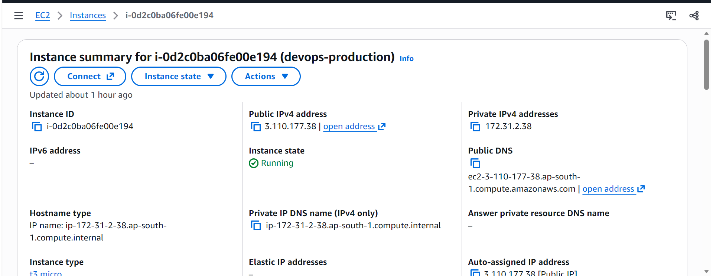
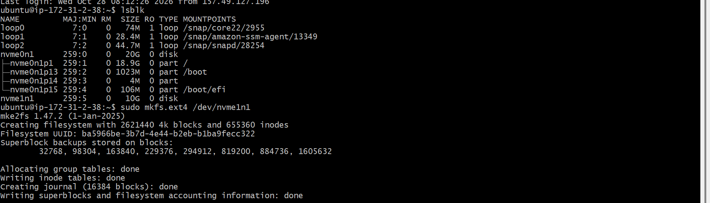
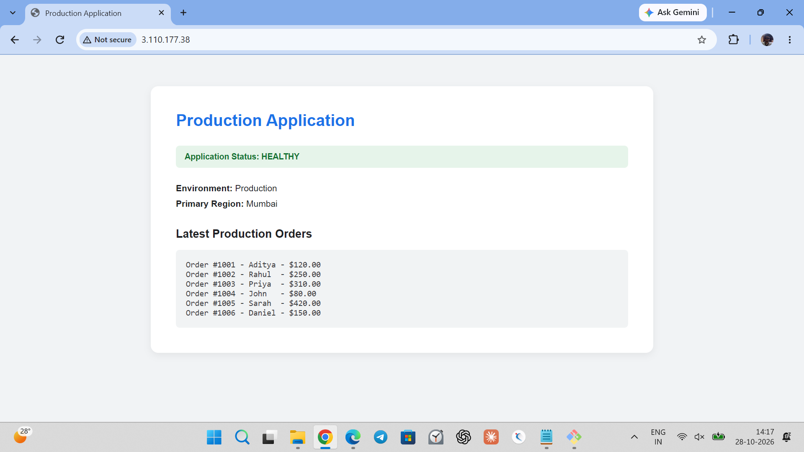
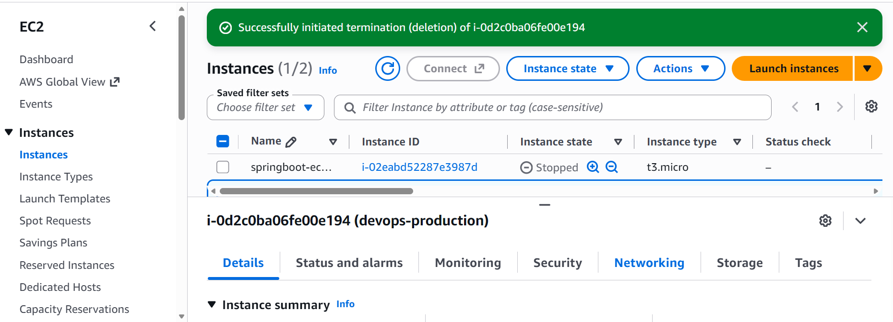
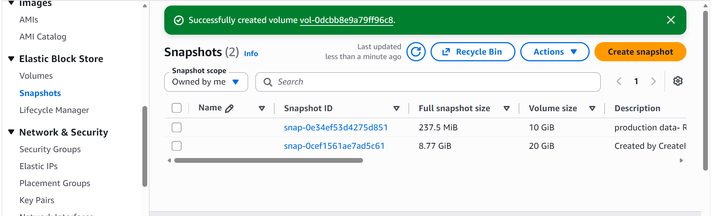
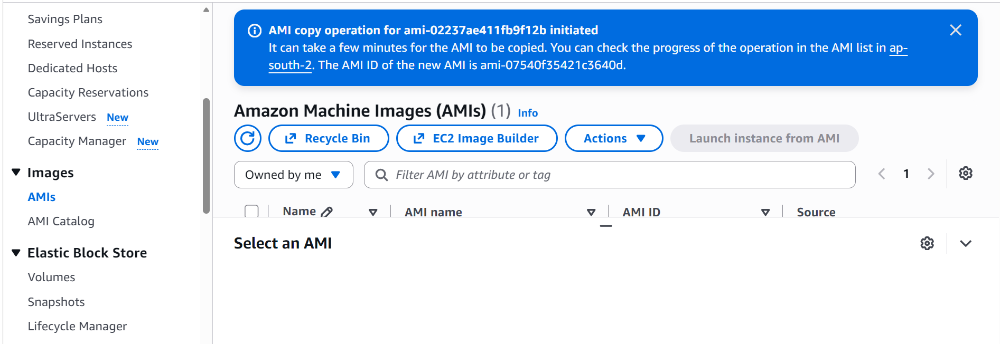
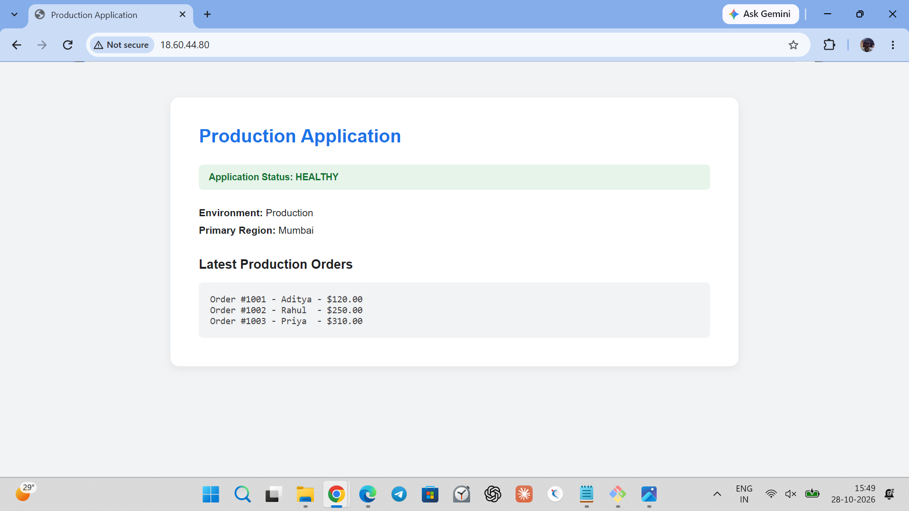

# AWS Disaster Recovery Lab: EC2, EBS and Cross-Region Failure

A hands-on lab where I deliberately broke a small web application on AWS and recovered it from three different failures: a **crashed EC2 instance**, **deleted data on an EBS volume**, and a **full regional outage** (Mumbai to Hyderabad).

- **Primary region:** Mumbai (`ap-south-1`)
- **DR region:** Hyderabad (`ap-south-2`)
- **Stack:** EC2 (Ubuntu), Nginx, EBS (`gp3`, ext4), AMI, EBS Snapshots

> This is a learning lab built manually through the AWS Console. It is not a production setup. See [Limitations and next steps](#limitations-and-next-steps).

---

## Failure scenarios at a glance

| # | Failure | What I simulated | How I recovered | AWS feature used |
| :-- | :-- | :-- | :-- | :-- |
| 1 | EC2 failure | Terminated the running instance | Launched a new instance from a pre-baked AMI and reattached the data volume | Custom AMI (`devopsshack-base-ami`) |
| 2 | EBS data loss | Deleted `orders.txt` with `sudo rm` | Created a new volume from the last snapshot and mounted it | EBS Snapshot |
| 3 | Regional outage | Treated `ap-south-1` as unavailable | Copied the AMI and snapshot to `ap-south-2`, launched an instance and attached a volume built from the copied snapshot | Cross-region AMI and snapshot copy |

---

## Architecture

```text
[ Primary Region: Mumbai (ap-south-1) ]
   |
   |-- EC2 web server (Nginx) ---- root OS volume (/)
   |                                    |  (create image)
   |                                    v
   |                              [ Golden AMI ]
   |
   '-- Separate EBS data volume (/dev/nvme1n1, ext4)
         mounted at /production_data
         /var/www/html/orders.txt  -->  symlink to /production_data/orders.txt
                |  (create snapshot)
                v
          [ EBS Snapshot ]
                |
   =============|=====  copy to another region  =====
                v
[ DR Region: Hyderabad (ap-south-2) ]
   |
   |-- EC2 launched from the copied AMI
   '-- New EBS volume created from the copied snapshot,
       attached, mounted and symlinked the same way
```

**Key design choice:** the application data lives on its own EBS volume, separate from the OS disk. The server can be replaced from an AMI at any time, and the data can be restored independently from a snapshot.

---

## Step-by-step

### Phase 1: Baseline setup (Mumbai)

1. Launched an Ubuntu EC2 instance in `ap-south-1` and installed Nginx.
2. Opened the app. It showed an error because the persistent storage was not attached yet.
3. Attached a new 10 GiB `gp3` EBS volume (`/dev/nvme1n1`).
4. Formatted it as ext4 and mounted it at `/production_data`.
5. Created a symlink so Nginx serves the orders file from the data volume.
6. Confirmed the app loaded the orders from the persistent volume.

The same steps are in [`scripts/setup_app.sh`](scripts/setup_app.sh):

```bash
sudo mkfs.ext4 /dev/nvme1n1                      # only if the disk is unformatted
sudo mkdir -p /production_data
sudo mount /dev/nvme1n1 /production_data
sudo ln -sf /production_data/orders.txt /var/www/html/orders.txt
sudo systemctl enable nginx && sudo systemctl restart nginx
```





### Phase 2: Failure 1, EC2 instance crash

- Created an AMI (`devopsshack-base-ami`) from the configured instance beforehand.
- **Simulated failure:** terminated the production instance.
- **Recovery:** launched a replacement from the AMI and reattached the surviving data volume. The app came back with the same configuration and data.



### Phase 3: Failure 2, data deleted from EBS

- Took an EBS snapshot of the data volume while the data was healthy.
- **Simulated failure:** deleted the file with `sudo rm orders.txt`.
- **Recovery:** detached the damaged volume, created a new volume from the snapshot, attached it and mounted it again.



### Phase 4: Failure 3, regional outage (Mumbai to Hyderabad)

- Copied the AMI and the EBS snapshot from `ap-south-1` to `ap-south-2`.
- Launched an EC2 instance in Hyderabad from the copied AMI.
- Created a new 10 GiB volume from the copied snapshot, attached it, mounted it and recreated the symlink.
- Opened the DR instance's public IP in the browser and confirmed the application and its orders were available.




> The page text still says "Primary Region: Mumbai" because the restored copy is the same application and I did not change its content for the DR region.

---

## What this lab demonstrates

- Separating data from the OS disk makes both compute failure and data failure easier to recover from.
- An AMI restores the server setup. A snapshot restores the data. You need both.
- Backups only count once you have restored from them, so I tested every recovery path.
- Cross-region copies are what protect against a regional failure. Same-region snapshots and AMIs do not.

---

## Limitations and next steps

I did **not** measure recovery time (RTO) or recovery point (RPO) in this lab, so no figures are claimed. RPO depends on how recent the last snapshot is, and RTO depends on how fast the AMI and volume can be restored. Measuring both is the next step.

Other gaps I know about:

- Everything was done manually in the console. No Infrastructure as Code yet.
- Snapshots were created by hand. There is no automated schedule.
- The mount in `setup_app.sh` is not persistent across reboots (no `/etc/fstab` entry).
- Failover was manual. There is no DNS-based routing and no health checks.

Planned improvements:

- [ ] Time each recovery and record the real RTO
- [ ] Automate snapshots and retention with AWS Backup or Data Lifecycle Manager
- [ ] Add DNS failover with Route 53 health checks
- [ ] Rebuild the whole setup with Terraform
- [ ] Add an `/etc/fstab` entry so the mount survives reboots

---

## Cost control

- Created an AWS Zero-Spend Budget alert before starting.
- Deleted all instances, volumes, snapshots and AMIs in both regions after the lab.

---

## Repository structure

```text
.
|-- README.md
|-- scripts/
|   '-- setup_app.sh
'-- docs/
    '-- images/        # screenshots of each step
```
